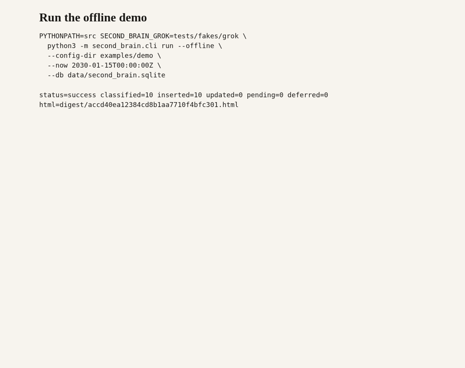
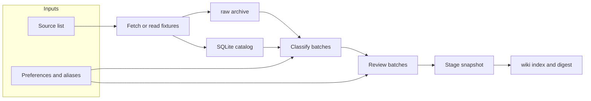

[English](README.md) | [简体中文](README.zh-CN.md)

# local-feed-wiki

The Python package and CLI are still called `second-brain` / `second_brain` for now.

Turn your RSS, podcast, and YouTube subscriptions into a local, evidence-first wiki: raw sources stay immutable, the wiki regenerates, and a minority page shows where your sources disagree.

[](https://github.com/Dxfory/local-feed-wiki/actions/workflows/offline.yml)
[](LICENSE)
[](https://www.python.org/)



## Try it

This block installs the two pinned packages and runs the English offline demo in [`examples/demo`](examples/demo). The fixture is described in [`examples/demo/README.md`](examples/demo/README.md). Digest labels in that demo are still Chinese.

```bash
python3 -m venv .venv
. .venv/bin/activate
python -m pip install feedparser==6.0.14 PyYAML==6.0.3
PYTHONPATH=src SECOND_BRAIN_GROK=tests/fakes/grok \
  python3 -m second_brain.cli run --offline \
  --config-dir examples/demo \
  --now 2030-01-15T00:00:00Z \
  --db data/second_brain.sqlite
```

Open `wiki/index.md`, then the HTML path printed as `html=`. `data/`, `raw/`, `wiki/`, `.grok-sandbox/`, and `.grok-tmp/` are local run state. They are gitignored.

## Why

- **Local.** It stays on your machine. There is no web app, account, notification bot, or daemon in this tree.
- **Traceable evidence.** It stores immutable originals under `raw/` and the catalog in a SQLite file.
- **Side-by-side disagreement.** When two sources disagree on the same claim, the minority page shows the sentences side by side.

## Quickstart (60 seconds)

Requires Python 3.13 or newer. Runtime packages are `feedparser==6.0.14` and `PyYAML==6.0.3`.

The block repeats the install, runs the English demo (`--config-dir examples/demo`), then runs the original synthetic fixture (`--config-dir examples/offline`). Both pin the clock at `2030-01-15T00:00:00Z`.

```bash
python3 -m venv .venv
. .venv/bin/activate
python -m pip install feedparser==6.0.14 PyYAML==6.0.3
PYTHONPATH=src SECOND_BRAIN_GROK=tests/fakes/grok \
  python3 -m second_brain.cli run --offline \
  --config-dir examples/demo \
  --now 2030-01-15T00:00:00Z \
  --db data/second_brain.sqlite
PYTHONPATH=src SECOND_BRAIN_GROK=tests/fakes/grok \
  python3 -m second_brain.cli run --offline \
  --config-dir examples/offline \
  --now 2030-01-15T00:00:00Z \
  --db data/second_brain.sqlite
```

Open `wiki/index.md`, then the HTML path printed as `html=`.

The project root is the checkout that contains `src/second_brain`. Override it with `--root PATH` or with a non-empty `SECOND_BRAIN_ROOT`. A relative override is resolved from the current working directory and is not followed if it is a symlink. The root itself must be a real directory.

## How it works

The method note behind the three layers is [Andrej Karpathy's llm-wiki gist](https://gist.github.com/karpathy/442a6bf555914893e9891c11519de94f). This project keeps the idea and none of the text: `raw/` is evidence that is not overwritten, `wiki/` is a view that can be generated again, and the schema is how updates are allowed to happen.



## Compared with

| Feature | local-feed-wiki | a classic RSS reader | Readwise Reader | Feedly |
| --- | --- | --- | --- | --- |
| data stays on your machine | yes | varies | no (hosted) | no (hosted) |
| immutable raw archive | yes | varies | varies | varies |
| regenerable wiki | yes | varies | varies | varies |
| disagreement page | yes | varies | varies | varies |
| needs an account | no | varies | yes | yes |
| open source | yes | varies | no | no |

`varies` means this page does not state one fact for that cell. A classic RSS reader is a category, so that column is `varies`.

## Scope

Nothing here is a hosted account, a chat log, or a trading signal.

That page compares wording already in your library. It is not a market conclusion, a position, or a target price.

The footer repeats the limit: a minority page only compares sentences in the library.

A live model call is a separate gate. The offline demo never opens a socket and never needs a real model binary.

A real fetch uses `--live` and all of the following in `config/runtime.yaml`:

- `offline: false`
- `live_authorized: true`
- `billing_path` set to `session` or `api`
- `billing_path_verified: true`
- `tool_policy_verified: true`
- `SECOND_BRAIN_GROK` set to a regular file that is the completion binary

Missing any one of those stops the process before a request and before a model call.

## What it does

- Fetches public feeds you list, or reads synthetic files when you stay offline.
- Stores immutable originals under `raw/` and the catalog in a SQLite file.
- Classifies new items in batches and, when several sources touch one topic, writes a short comparison.
- Publishes one HTML digest, an index, and a snapshot manifest under `wiki/`.
- Refuses to start a second run while `data/run.lock` is held.

## Sample output

This excerpt is from a first run of the synthetic fixtures in [`examples/offline`](examples/offline), with the clock fixed at `2030-01-15T00:00:00Z`. The titles and links are invented. The counters below stay the same on that first run. The digest id is new every run, so the `html=` path is `digest/<run-id>.html`.

```text
status=success classified=3 inserted=4 updated=0 pending=1 deferred=0 html=digest/<run-id>.html
```

The digest then says, in short:

- Recommended: 合成文章甲 and 合成文章乙 from `example-blog`, and 已有文稿 from `example-podcast`. Each card carries the source id, the topic 离线, the reason 离线合成结果, and an `https://example.com/...` link.
- Waiting on a transcript: 只有音频, because the fixture has audio and no text.
- Must-read, skip, and minority sections are empty for this tiny fixture.
- The footer repeats the limit: a minority page only compares sentences in the library.

`wiki/index.md` points at that digest and at `snapshots/<run_id>/`.

## Your own feeds

`config/sources.yaml` is gitignored. Start from the public examples:

```bash
cp config/sources.example.yaml config/sources.yaml
cp config/preferences.example.md config/preferences.md
cp config/topic_aliases.example.yaml config/topic_aliases.yaml
cp config/runtime.example.yaml config/runtime.yaml
```

[`config/sources.example.yaml`](config/sources.example.yaml) lists four public https feeds (Hacker News, BBC World, Planet Money, and the Google Developers YouTube channel). Edit the copy. Do not commit it.

Public starter packs are in [`examples/feeds/`](examples/feeds/): [`ai-research.yaml`](examples/feeds/ai-research.yaml), [`finance-podcasts.yaml`](examples/feeds/finance-podcasts.yaml), and [`indie-builders.yaml`](examples/feeds/indie-builders.yaml). Copy entries into `config/sources.yaml`.

Offline mode rejects every non-file source, so those https feeds do not run under `--offline`. A real fetch uses `--live` and all of the following in `config/runtime.yaml`:

- `offline: false`
- `live_authorized: true`
- `billing_path` set to `session` or `api`
- `billing_path_verified: true`
- `tool_policy_verified: true`
- `SECOND_BRAIN_GROK` set to a regular file that is the completion binary

Missing any one of those stops the process before a request and before a model call. The checked-in example leaves every live flag closed. The example budgets are sized for about 21 sources: 21 classify batches and 8 review batches. Classify holds at most 8 items per batch, so 21 batches can cover one batch per source. Review holds at most 4 topics per batch, so 8 batches cover 32 topics. The numbers count calls, not money. The code defaults stay smaller; the example file is what a real list should copy.

`--example-config` reads the tracked `*.example.*` files and does not write `config/sources.yaml`.

## Architecture

`raw/` is the evidence. `wiki/` is the replaceable reading view. The schema in [`src/second_brain/models.py`](src/second_brain/models.py) is what a run is allowed to store. The completion step is an external binary selected by `SECOND_BRAIN_GROK`. Tests ship a fake at `tests/fakes/grok` and refuse any other file while offline.

URL checks reject loopback, link-local, metadata hosts, credential query keys, and a fixed set of video-site hosts. They do not resolve DNS, so they are not a full SSRF defense. Redirects are not followed automatically, and the client does not inherit proxy environment variables.

## Roadmap

- A `check` command that validates config and prints hosts and budgets without fetching.
- An OPML-to-YAML helper that writes to stdout.
- Stricter source-list checks: duplicate URLs, an empty list, and a cap on `backfill_days`.
- A `wiki/latest.txt` pointer written beside the publisher, not inside the frozen snapshot step.
- Fetch-only operation without a model call is not available yet.
- No vector index, web framework, background daemon, or audio transcription in this tree. Scheduling stays outside the program.

## Good first issues

See [`docs/GOOD_FIRST_ISSUES.md`](docs/GOOD_FIRST_ISSUES.md).

## License

[MIT](LICENSE). Copyright (c) 2026 second-brain contributors.
