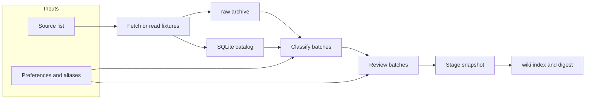

# second-brain

A local reader for public feeds. It keeps the original bytes, then regenerates a small wiki you can open in a browser. Nothing here is a hosted account, a chat log, or a trading signal.

You point it at RSS, podcast RSS, and YouTube channel Atom feeds. Each run files what it has not filed yet, sorts new items into read / skim / skip, and writes a static digest. When two sources disagree on the same claim, the minority page shows the sentences side by side. That page compares wording already in your library. It is not a market conclusion, a position, or a target price.

The method note behind the three layers is [Andrej Karpathy's llm-wiki gist](https://gist.github.com/karpathy/442a6bf555914893e9891c11519de94f). This project keeps the idea and none of the text: `raw/` is evidence that is not overwritten, `wiki/` is a view that can be generated again, and the schema is how updates are allowed to happen.

## What it does

- Fetches public feeds you list, or reads synthetic files when you stay offline.
- Stores immutable originals under `raw/` and the catalog in a SQLite file.
- Classifies new items in batches and, when several sources touch one topic, writes a short comparison.
- Publishes one HTML digest, an index, and a snapshot manifest under `wiki/`.
- Refuses to start a second run while `data/run.lock` is held.
- Stays on your machine. There is no web app, account, notification bot, or daemon in this tree.

A live model call is a separate gate. The offline demo never opens a socket and never needs a real model binary.

## Sample output

This excerpt is from the synthetic fixtures in `examples/offline`, with the clock fixed at `2030-01-15T00:00:00Z`. The titles and links are invented.

```text
status=success classified=3 inserted=4 updated=0 pending=1 deferred=0 html=digest/18fc0fe4723c4e2bb91a5144e87900f3.html
```

The digest then says, in short:

- Recommended: 合成文章甲 and 合成文章乙 from `example-blog`, and 已有文稿 from `example-podcast`. Each card carries the source id, the topic 离线, the reason 离线合成结果, and an `https://example.com/...` link.
- Waiting on a transcript: 只有音频, because the fixture has audio and no text.
- Must-read, skip, and minority sections are empty for this tiny fixture.
- The footer repeats the limit: a minority page only compares sentences in the library.

`wiki/index.md` points at that digest and at `snapshots/<run_id>/`.

## Quickstart

Requires Python 3.13 or newer. Runtime packages are `feedparser==6.0.14` and `PyYAML==6.0.3`.

```bash
python3 -m venv .venv
. .venv/bin/activate
python -m pip install feedparser==6.0.14 PyYAML==6.0.3
PYTHONPATH=src SECOND_BRAIN_GROK=tests/fakes/grok \
  python3 -m second_brain.cli run --offline \
  --config-dir examples/offline \
  --now 2030-01-15T00:00:00Z \
  --db data/second_brain.sqlite
```

Open `wiki/index.md`, then the HTML path printed as `html=`. `data/`, `raw/`, `wiki/`, `.grok-sandbox/`, and `.grok-tmp/` are local run state. They are gitignored.

The project root is the checkout that contains `src/second_brain`. Override it with `--root PATH` or with a non-empty `SECOND_BRAIN_ROOT`. A relative override is resolved from the current working directory and is not followed if it is a symlink. The root itself must be a real directory.

### Your own feeds

`config/sources.yaml` is gitignored. Start from the public examples:

```bash
cp config/sources.example.yaml config/sources.yaml
cp config/preferences.example.md config/preferences.md
cp config/topic_aliases.example.yaml config/topic_aliases.yaml
cp config/runtime.example.yaml config/runtime.yaml
```

`config/sources.example.yaml` lists four public https feeds (Hacker News, BBC World, Planet Money, and the Google Developers YouTube channel). Edit the copy. Do not commit it.

Offline mode rejects every non-file source, so those https feeds do not run under `--offline`. A real fetch uses `--live` and all of the following in `config/runtime.yaml`:

- `offline: false`
- `live_authorized: true`
- `billing_path` set to `session` or `api`
- `billing_path_verified: true`
- `tool_policy_verified: true`
- `SECOND_BRAIN_GROK` set to a regular file that is the completion binary

Missing any one of those stops the process before a request and before a model call. The checked-in example leaves every live flag closed. The example budgets are sized for about 21 sources: 21 classify batches and 8 review batches. Classify holds at most 8 items per batch, so 21 batches can cover one batch per source. Review holds at most 4 topics per batch, so 8 batches cover 32 topics. The numbers count calls, not money. The code defaults stay smaller; the example file is what a real list should copy.

`--example-config` reads the tracked `*.example.*` files and does not write `config/sources.yaml`.

## Architecture



`raw/` is the evidence. `wiki/` is the replaceable reading view. The schema in `src/second_brain/models.py` is what a run is allowed to store. The completion step is an external binary selected by `SECOND_BRAIN_GROK`. Tests ship a fake at `tests/fakes/grok` and refuse any other file while offline.

URL checks reject loopback, link-local, metadata hosts, credential query keys, and a fixed set of video-site hosts. They do not resolve DNS, so they are not a full SSRF defense. Redirects are not followed automatically, and the client does not inherit proxy environment variables.

## Roadmap

- A `check` command that validates config and prints hosts and budgets without fetching.
- An OPML-to-YAML helper that writes to stdout.
- Stricter source-list checks: duplicate URLs, an empty list, and a cap on `backfill_days`.
- A `wiki/latest.txt` pointer written beside the publisher, not inside the frozen snapshot step.
- Fetch-only operation without a model call is not available yet.
- No vector index, web framework, background daemon, or audio transcription in this tree. Scheduling stays outside the program.

Starter tasks are listed in [`docs/GOOD_FIRST_ISSUES.md`](docs/GOOD_FIRST_ISSUES.md).

## License

[MIT](LICENSE). Copyright (c) 2026 second-brain contributors.

---

# 中文

本地的公开订阅阅读器。原文留在磁盘上，阅读页可以重新生成。它不是托管账号，不是聊天记录，也不是交易信号。

它读取你列出的 RSS、播客 RSS 和 YouTube 频道 Atom。每次运行归档还没归档的更新，把新条目分成必读、推荐阅读和不推荐，并写出一份静态摘要。两个来源对同一命题说法不同时，非共识页把库里的句子并列出来。那一页只对照已经收录的句子，不是市场结论，不是仓位，也不是目标价。

三层想法来自 [Andrej Karpathy 的说明](https://gist.github.com/karpathy/442a6bf555914893e9891c11519de94f)。这里只用想法，不复制原文：`raw/` 是不覆盖的证据，`wiki/` 是可重新生成的阅读页，schema 规定更新可以怎么发生。

## 它做什么

- 抓取你列出的公开源；离线时只读合成文件。
- 把不可变原文放进 `raw/`，目录放进 SQLite。
- 分批分类；多个来源碰到同一主题时写简短对照。
- 在 `wiki/` 发布一份 HTML 摘要、索引和快照清单。
- `data/run.lock` 被占用时不再开始第二次运行。
- 只在本机运行。这个树里没有网页、账号、通知或常驻进程。

真实模型调用是另一道门。离线演示不开网络，也不需要真实的模型程序。

## 示例输出

下面来自 `examples/offline` 的合成夹具，时钟固定为 `2030-01-15T00:00:00Z`。标题和链接都是虚构的。

```text
status=success classified=3 inserted=4 updated=0 pending=1 deferred=0 html=digest/18fc0fe4723c4e2bb91a5144e87900f3.html
```

摘要的大意是：

- 推荐阅读：`example-blog` 的合成文章甲、合成文章乙，以及 `example-podcast` 的已有文稿。每条带有来源 id、主题「离线」、理由「离线合成结果」，以及 `https://example.com/...` 链接。
- 待转写：只有音频。夹具里有音频、没有文字。
- 这份小夹具的必读、不推荐和非共识都是空的。
- 脚注写明：非共识页只对照库内句子。

`wiki/index.md` 指向这份摘要和 `snapshots/<run_id>/`。

## 快速开始

需要 Python 3.13 或更新版本。运行依赖是 `feedparser==6.0.14` 和 `PyYAML==6.0.3`。

```bash
python3 -m venv .venv
. .venv/bin/activate
python -m pip install feedparser==6.0.14 PyYAML==6.0.3
PYTHONPATH=src SECOND_BRAIN_GROK=tests/fakes/grok \
  python3 -m second_brain.cli run --offline \
  --config-dir examples/offline \
  --now 2030-01-15T00:00:00Z \
  --db data/second_brain.sqlite
```

先看 `wiki/index.md`，再打开标准输出里 `html=` 指向的文件。`data/`、`raw/`、`wiki/`、`.grok-sandbox/` 和 `.grok-tmp/` 是本地运行状态，已被忽略，不要提交。

项目根是包含 `src/second_brain` 的检出目录。用 `--root PATH` 或非空的 `SECOND_BRAIN_ROOT` 改掉它。相对路径按当前工作目录拼成绝对路径，不跟随符号链接。根本身必须是真实目录。

### 换成自己的订阅

`config/sources.yaml` 不入库。从公开示例复制：

```bash
cp config/sources.example.yaml config/sources.yaml
cp config/preferences.example.md config/preferences.md
cp config/topic_aliases.example.yaml config/topic_aliases.yaml
cp config/runtime.example.yaml config/runtime.yaml
```

`config/sources.example.yaml` 有四个公开 https 源：Hacker News、BBC World、Planet Money，以及 Google Developers 的 YouTube 频道。改副本，不要提交。

离线模式拒绝所有非 file 源，所以这些 https 源不能配 `--offline`。真实抓取用 `--live`，并且 `config/runtime.yaml` 里要同时满足：

- `offline: false`
- `live_authorized: true`
- `billing_path` 为 `session` 或 `api`
- `billing_path_verified: true`
- `tool_policy_verified: true`
- `SECOND_BRAIN_GROK` 指向一个普通文件，也就是补全程序

少任何一项，都会在发请求和调用模型之前停下来。仓库里的示例把在线旗标全部关着。示例预算按大约 21 个源来写：分类 21 批，短评 8 批。分类每批最多 8 条，21 批可以每个源留一批。短评每批最多 4 个主题，8 批是 32 个主题。这些数字是调用次数，不是金额。代码里的默认值更小；真实名单应该复制示例文件。

`--example-config` 只读入库的 `*.example.*`，不会写成 `config/sources.yaml`。

## 结构

英文部分的图同样适用。`raw/` 是证据，`wiki/` 是可替换的阅读页。`src/second_brain/models.py` 里的 schema 规定一次运行可以存什么。补全步骤是外部程序，由 `SECOND_BRAIN_GROK` 选择。测试自带 `tests/fakes/grok`，离线时拒绝任何其他文件。

URL 检查拒绝回环、链路本地、metadata 主机、凭据 query，以及一组固定的视频站主机。它不做 DNS 解析，所以不是完整的 SSRF 防护。客户端不自动跟随重定向，也不继承代理环境变量。

## 路线

- 增加 `check`：只校验配置并打印主机和预算，不抓取。
- 增加把 OPML 打到标准输出的小工具。
- 收紧订阅名单：重复 URL、空名单，以及 `backfill_days` 的上限。
- 在发布步骤旁边写 `wiki/latest.txt`，不改冻结的快照函数。
- 目前还不能在不调用模型的情况下只抓取。
- 这个树里不做向量索引、网页框架、常驻进程或音频转写。定时由使用者自己安排。

可以从 [`docs/GOOD_FIRST_ISSUES.md`](docs/GOOD_FIRST_ISSUES.md) 里领一件具体的小事。

## 许可

[MIT](LICENSE)。Copyright (c) 2026 second-brain contributors。
