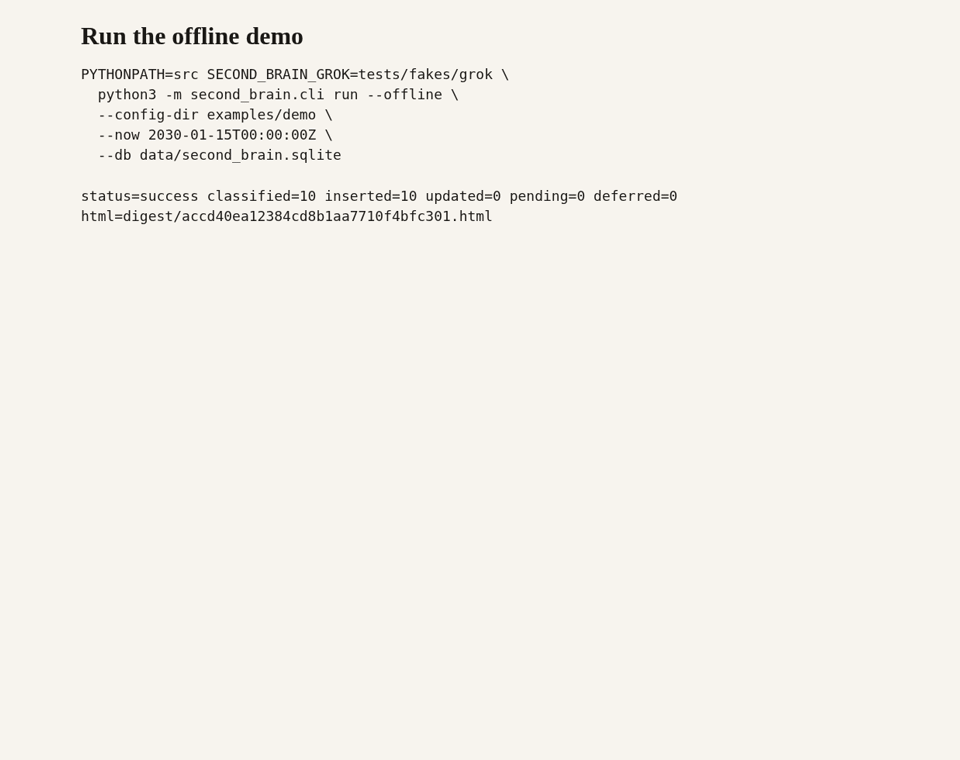
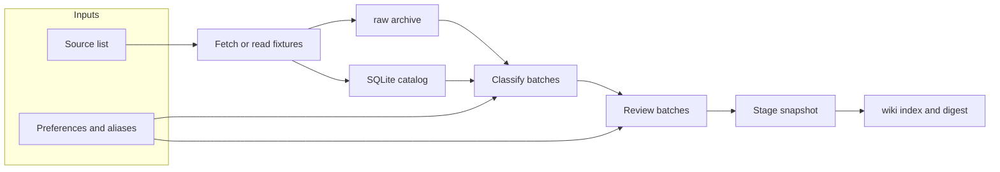

[English](README.md) | [简体中文](README.zh-CN.md)

# local-feed-wiki

Python 包和 CLI 目前仍叫 `second-brain` / `second_brain`。

把你的 RSS、播客和 YouTube 订阅做成一份本地的、以证据为先的 wiki：原始来源保持不可变，wiki 可以重新生成，非共识页标出来源哪里不一致。

[](https://github.com/Dxfory/local-feed-wiki/actions/workflows/offline.yml)
[](LICENSE)
[](https://www.python.org/)



## 先跑一次

下面这段命令会装上两个固定版本的依赖，并运行 [`examples/demo`](examples/demo) 里的英文离线演示。夹具说明在 [`examples/demo/README.md`](examples/demo/README.md)。这份演示的摘要标签仍是中文。

```bash
python3 -m venv .venv
. .venv/bin/activate
python -m pip install feedparser==6.0.14 PyYAML==6.0.3
PYTHONPATH=src SECOND_BRAIN_GROK=tests/fakes/grok \
  python3 -m second_brain.cli run --offline \
  --config-dir examples/demo \
  --now 2030-01-15T00:00:00Z \
  --db data/second_brain.sqlite
```

先看 `wiki/index.md`，再打开标准输出里 `html=` 指向的文件。`data/`、`raw/`、`wiki/`、`.grok-sandbox/` 和 `.grok-tmp/` 是本地运行状态，已被忽略，不要提交。

## 为什么

- **本地。** 只在本机运行。这个树里没有网页、账号、通知或常驻进程。
- **证据可追溯。** 把不可变原文放进 `raw/`，目录放进 SQLite。
- **分歧并排。** 两个来源对同一命题说法不同时，非共识页把句子并列出来。

## 快速开始（60 秒）

需要 Python 3.13 或更新版本。运行依赖是 `feedparser==6.0.14` 和 `PyYAML==6.0.3`。

下面重复安装，先跑英文演示（`--config-dir examples/demo`），再跑原来的合成夹具（`--config-dir examples/offline`）。两次都把时钟固定在 `2030-01-15T00:00:00Z`。

```bash
python3 -m venv .venv
. .venv/bin/activate
python -m pip install feedparser==6.0.14 PyYAML==6.0.3
PYTHONPATH=src SECOND_BRAIN_GROK=tests/fakes/grok \
  python3 -m second_brain.cli run --offline \
  --config-dir examples/demo \
  --now 2030-01-15T00:00:00Z \
  --db data/second_brain.sqlite
PYTHONPATH=src SECOND_BRAIN_GROK=tests/fakes/grok \
  python3 -m second_brain.cli run --offline \
  --config-dir examples/offline \
  --now 2030-01-15T00:00:00Z \
  --db data/second_brain.sqlite
```

先看 `wiki/index.md`，再打开标准输出里 `html=` 指向的文件。

项目根是包含 `src/second_brain` 的检出目录。用 `--root PATH` 或非空的 `SECOND_BRAIN_ROOT` 改掉它。相对路径按当前工作目录拼成绝对路径，不跟随符号链接。根本身必须是真实目录。

## 它怎么工作

三层想法来自 [Andrej Karpathy 的说明](https://gist.github.com/karpathy/442a6bf555914893e9891c11519de94f)。这里只用想法，不复制原文：`raw/` 是不覆盖的证据，`wiki/` 是可重新生成的阅读页，schema 规定更新可以怎么发生。



## 对照

| 功能 | local-feed-wiki | 传统 RSS 阅读器 | Readwise Reader | Feedly |
| --- | --- | --- | --- | --- |
| 数据留在你的机器上 | yes | varies | no (hosted) | no (hosted) |
| 不可变原文归档 | 是 | varies | varies | varies |
| 可重新生成的 wiki | 是 | varies | varies | varies |
| 非共识页 | 是 | varies | varies | varies |
| 需要账号 | 否 | varies | 是 | 是 |
| 开源 | 是 | varies | 否 | 否 |

`varies` 表示这一格没有写成一条确定事实。传统 RSS 阅读器是一类产品，所以那一列是 `varies`。

## 范围

它不是托管账号，不是聊天记录，也不是交易信号。

那一页只对照已经收录的句子，不是市场结论，不是仓位，也不是目标价。

脚注写明：非共识页只对照库内句子。

真实模型调用是另一道门。离线演示不开网络，也不需要真实的模型程序。

真实抓取用 `--live`，并且 `config/runtime.yaml` 里要同时满足：

- `offline: false`
- `live_authorized: true`
- `billing_path` 为 `session` 或 `api`
- `billing_path_verified: true`
- `tool_policy_verified: true`
- `SECOND_BRAIN_GROK` 指向一个普通文件，也就是补全程序

少任何一项，都会在发请求和调用模型之前停下来。

## 它做什么

- 抓取你列出的公开源；离线时只读合成文件。
- 把不可变原文放进 `raw/`，目录放进 SQLite。
- 分批分类；多个来源碰到同一主题时写简短对照。
- 在 `wiki/` 发布一份 HTML 摘要、索引和快照清单。
- `data/run.lock` 被占用时不再开始第二次运行。

## 示例输出

下面来自 [`examples/offline`](examples/offline) 的合成夹具在干净库上的第一次运行，时钟固定为 `2030-01-15T00:00:00Z`。标题和链接都是虚构的。下面的计数在那一次运行里是稳定的。摘要 id 每次都会变，所以 `html=` 的路径是 `digest/<run-id>.html`。

```text
status=success classified=3 inserted=4 updated=0 pending=1 deferred=0 html=digest/<run-id>.html
```

摘要的大意是：

- 推荐阅读：`example-blog` 的合成文章甲、合成文章乙，以及 `example-podcast` 的已有文稿。每条带有来源 id、主题「离线」、理由「离线合成结果」，以及 `https://example.com/...` 链接。
- 待转写：只有音频。夹具里有音频、没有文字。
- 这份小夹具的必读、不推荐和非共识都是空的。
- 脚注写明：非共识页只对照库内句子。

`wiki/index.md` 指向这份摘要和 `snapshots/<run_id>/`。

## 换成自己的订阅

`config/sources.yaml` 不入库。从公开示例复制：

```bash
cp config/sources.example.yaml config/sources.yaml
cp config/preferences.example.md config/preferences.md
cp config/topic_aliases.example.yaml config/topic_aliases.yaml
cp config/runtime.example.yaml config/runtime.yaml
```

[`config/sources.example.yaml`](config/sources.example.yaml) 有四个公开 https 源：Hacker News、BBC World、Planet Money，以及 Google Developers 的 YouTube 频道。改副本，不要提交。

公开的起步名单在 [`examples/feeds/`](examples/feeds/)：[`ai-research.yaml`](examples/feeds/ai-research.yaml)、[`finance-podcasts.yaml`](examples/feeds/finance-podcasts.yaml)、[`indie-builders.yaml`](examples/feeds/indie-builders.yaml)。把条目抄进 `config/sources.yaml`。

离线模式拒绝所有非 file 源，所以这些 https 源不能配 `--offline`。真实抓取用 `--live`，并且 `config/runtime.yaml` 里要同时满足：

- `offline: false`
- `live_authorized: true`
- `billing_path` 为 `session` 或 `api`
- `billing_path_verified: true`
- `tool_policy_verified: true`
- `SECOND_BRAIN_GROK` 指向一个普通文件，也就是补全程序

少任何一项，都会在发请求和调用模型之前停下来。仓库里的示例把在线旗标全部关着。示例预算按大约 21 个源来写：分类 21 批，短评 8 批。分类每批最多 8 条，21 批可以每个源留一批。短评每批最多 4 个主题，8 批是 32 个主题。这些数字是调用次数，不是金额。代码里的默认值更小；真实名单应该复制示例文件。

`--example-config` 只读入库的 `*.example.*`，不会写成 `config/sources.yaml`。

## 结构

`raw/` 是证据，`wiki/` 是可替换的阅读页。[`src/second_brain/models.py`](src/second_brain/models.py) 里的 schema 规定一次运行可以存什么。补全步骤是外部程序，由 `SECOND_BRAIN_GROK` 选择。测试自带 `tests/fakes/grok`，离线时拒绝任何其他文件。

URL 检查拒绝回环、链路本地、metadata 主机、凭据 query，以及一组固定的视频站主机。它不做 DNS 解析，所以不是完整的 SSRF 防护。客户端不自动跟随重定向，也不继承代理环境变量。

## 路线

- 增加 `check`：只校验配置并打印主机和预算，不抓取。
- 增加把 OPML 打到标准输出的小工具。
- 收紧订阅名单：重复 URL、空名单，以及 `backfill_days` 的上限。
- 在发布步骤旁边写 `wiki/latest.txt`，不改冻结的快照函数。
- 目前还不能在不调用模型的情况下只抓取。
- 这个树里不做向量索引、网页框架、常驻进程或音频转写。定时由使用者自己安排。

## 适合先做的事

可以从 [`docs/GOOD_FIRST_ISSUES.md`](docs/GOOD_FIRST_ISSUES.md) 里领一件具体的小事。

## 许可

[MIT](LICENSE)。Copyright (c) 2026 second-brain contributors。
